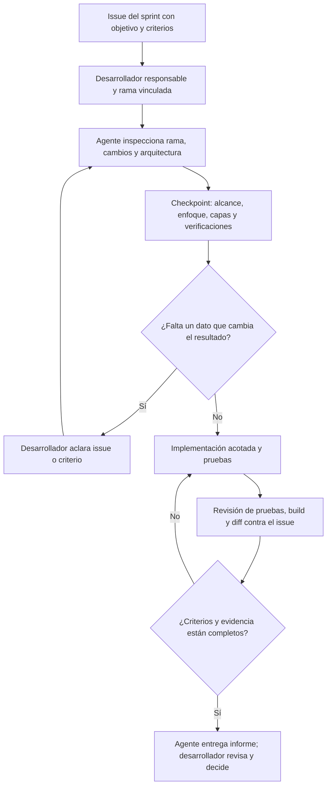

# TDDLab: flujo del harness de agentes

Este README describe cómo usar un agente de IA como apoyo para cada tarea asignada a un desarrollador durante un sprint. El flujo se basa en la presentación **TDDLab harness agentes IA** y en la estructura real del repositorio.

La presentación plantea el harness como instrucciones, contexto, flujo y verificaciones. El flujo de issue, rama, checkpoint y revisión todavía es una propuesta para que el equipo la revise, acuerde y pruebe con una tarea piloto.

## Qué es TDDLab

TDDLab reúne tres componentes:

| Componente | Responsabilidad principal | Código |
| --- | --- | --- |
| Aplicación web | Grupos, tareas, prácticas, entregas, usuarios, asistencia de IA y visualización TDD | `Web Ui/` |
| API | Casos de uso del servidor e integración con PostgreSQL, Firebase y servicios externos | `server/` |
| Extensión de VS Code | Ejecución de pruebas, terminal/vistas de la extensión y línea de tiempo TDD | `VSCodeExtension/` |

TDDLab ayuda a practicar TDD: la extensión ejecuta pruebas y muestra su secuencia temporal; la aplicación y la API dan soporte a grupos, tareas, prácticas y entregas, y permiten visualizar ciclos obtenidos de repositorios Git. Por eso, algunas tareas atraviesan más de un componente.

| Área | Entrada y coordinación | Aplicación, dominio y adaptadores |
| --- | --- | --- |
| Web | `Web Ui/src/app/` y `Web Ui/src/presentation/` | `Web Ui/src/modules/` organiza casos de uso, modelos/contratos y repositorios que llaman a la API o a servicios externos. |
| API | `server/src/routes/` y `server/src/controllers/` | `server/src/modules/` organiza casos de uso, modelos y repositorios; `server/src/config/` conecta PostgreSQL y Firebase. |
| Extensión | `VSCodeExtension/src/extension.ts` y `src/presentation/` | `src/application/` coordina acciones, `src/domain/` declara modelos y algunos puertos, y `src/infrastructure/` integra VS Code, procesos y archivos. |

El repositorio sigue una arquitectura hexagonal por intención, con diferencias entre componentes. Algunos módulos usan contratos explícitos —por ejemplo, los repositorios de grupos del frontend y TDD Cycles del servidor— y otros dependen directamente de clases de repositorio. Los cambios deben respetar el patrón local y mantener la dirección de dependencias hacia el dominio.

El harness documentado aquí trata el trabajo del agente en el desarrollo del producto. No reemplaza el ciclo TDD que TDDLab enseña y registra para los proyectos de estudiantes.

## Flujo de una tarea dentro del sprint



### 1. Preparar la tarea en la planificación

Cada unidad de trabajo debe tener un issue, una persona responsable y criterios de aceptación comprobables. Antes de registrar un issue nuevo, busca si ya hay uno equivalente. Si el agente no tiene acceso al tablero o permiso para crear issues, entrega un borrador para que lo revise el equipo.

Completa, como mínimo:

- **Objetivo:** qué resultado necesita el usuario o el sistema.
- **Criterios de aceptación:** comportamientos observables que permitan decidir si está terminado.
- **Fuera de alcance:** funciones que no se deben alterar, si hay riesgo de confusión.
- **Contexto técnico:** componente o flujo conocido, con enlaces o rutas si están disponibles.
- **Verificación esperada:** pruebas, compilación o revisión funcional que demuestre el resultado.

Cuando una tarea cruza la web, API y extensión, los criterios deben cubrir el recorrido afectado. Si el trabajo no puede verificarse como una unidad, divídelo en tareas con resultados revisables.

### 2. Vincular issue, persona y rama

El issue explica el objetivo; la rama contiene los cambios; la revisión compara el diff y sus pruebas con los criterios de ese issue. La presentación propone asociar una rama a cada issue.

Como formato inicial, el equipo puede acordar nombres como:

```text
feature/<issue-id>-<descripcion-corta>
fix/<issue-id>-<descripcion-corta>
refactor/<issue-id>-<descripcion-corta>
```

Este formato es una propuesta, no una convención que el repositorio ya aplique. No renombres automáticamente una rama existente. Si el issue no está vinculado a la rama abierta, aclara esa relación en el checkpoint y sigue la decisión del desarrollador responsable.

### 3. Asignar la tarea al desarrollador y preparar el contexto del agente

El desarrollador comparte el issue y entrega suficiente contexto para resolverlo. Puede usar esta plantilla; el prompting estructurado es opcional, pero los criterios del issue y el análisis de la rama son necesarios:

```text
Issue: <ID y enlace>
Objetivo: <resultado esperado>
Criterios de aceptación:
- <criterio verificable>
- <criterio verificable>
Fuera de alcance: <qué preservar o no modificar>
Contexto: <flujo, componente o restricciones conocidas>

Analiza primero la rama y el estado del workspace. Resume el flujo actual,
las capas afectadas, los cambios existentes y las verificaciones que usarás.
Después implementa solo este issue. Si falta un criterio que pueda cambiar
el comportamiento, pregúntame antes de modificar código.
```

### 4. El agente analiza antes de editar

Al iniciar cada tarea, el agente debe:

1. Leer `AGENTS.md`, el issue y la documentación local pertinente.
2. Comprobar la rama activa, el estado del workspace, el último commit y los cambios ya presentes.
3. Seguir el comportamiento desde la entrada (pantalla, endpoint o comando) hasta el caso de uso, los contratos/adaptadores y las pruebas.
4. Localizar búsquedas, configuraciones, imports dinámicos, comandos y assets asociados cuando la tarea implique limpiar o eliminar archivos.
5. Enviar un checkpoint breve con alcance entendido, plan, capas afectadas, verificaciones y dudas relevantes.

El análisis se hace en la rama de trabajo abierta; no se debe cambiar a `main` para comenzar una tarea asignada. Si falta información esencial, el desarrollador completa el issue antes de que el agente avance. Si el alcance está claro, el agente continúa tras comunicar el checkpoint; el checkpoint no es una aprobación adicional.

### 5. Implementar solo el alcance acordado

El agente aplica el cambio a través de las capas necesarias, manteniendo contratos y comportamiento no incluidos en el issue. Para cambios de comportamiento, usa Red–Green–Refactor cuando sea posible. No mezcla limpiezas, refactorizaciones generales ni formato de archivos no relacionados.

En tareas de eliminación, verifica referencias de código, configuraciones, scripts, rutas, pruebas y recursos antes de borrar. En TDDLab, `GitHub` puede referirse a autenticación o a análisis de repositorios/commits para las gráficas TDD; son capacidades distintas y se deben seguir por separado.

### 6. Verificar el resultado

Ejecuta los comandos del paquete afectado y cualquier verificación adicional que exijan los criterios. El repositorio no tiene scripts de trabajo en el `package.json` raíz; cada componente tiene los suyos.

**Web (`Web Ui/`):**

```bash
cd "Web Ui"
npm test -- --runInBand
npm run build
```

Para pruebas de navegador, inicia Vite en `http://localhost:5173` y ejecuta `npm run cy:run` desde `Web Ui/`.

**API (`server/`):**

```bash
cd server
npm test -- --runInBand
npm run tsc
```

**Extensión (`VSCodeExtension/`):**

```bash
cd VSCodeExtension
npm run compile
npm run lint
npm test
```

`npm test` de la extensión necesita el entorno de pruebas de VS Code. Si una prueba o integración no se puede ejecutar, registra esa limitación y no la presentes como aprobada. Ejecuta solo los paquetes relacionados con el alcance; los cambios que crucen componentes requieren comprobar todos los afectados.

Antes de informar, revisa `git diff --check`, `git status --short`, el diff completo y los criterios uno por uno. Separa resultados observados de suposiciones.

### 7. Entregar el trabajo al desarrollador responsable

El agente informa con este formato:

```text
Issue / rama:
Cambios y capas afectadas:
Criterios cubiertos:
Verificaciones ejecutadas y resultado:
Verificaciones pendientes y motivo:
Riesgos o bloqueos:
```

El desarrollador revisa el diff, confirma que el resultado responde al issue y decide si está listo para integrarse y cerrar. La rama y el informe deben permitir que otra persona compruebe la tarea sin depender de la conversación original.

## Lista breve por tarea

- [ ] Issue sin duplicado y con criterios de aceptación.
- [ ] Persona responsable y rama relacionada con el issue.
- [ ] Rama, estado y cambios existentes inspeccionados antes de editar.
- [ ] Flujo y pruebas relevantes localizados.
- [ ] Checkpoint del agente compartido; dudas importantes resueltas.
- [ ] Cambio acotado a los criterios del issue.
- [ ] Pruebas/build relevantes ejecutados o limitaciones informadas.
- [ ] Diff revisado y handoff entregado.

## Comandos de desarrollo habituales

Los README de cada componente contienen más información de configuración:

- [Frontend](<Web Ui/README.md>)
- [Servidor](server/README.md)
- [Extensión de VS Code](VSCodeExtension/README.md)
