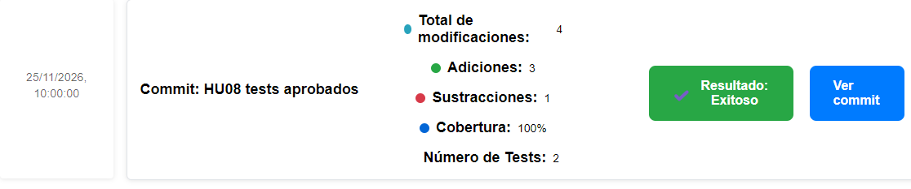
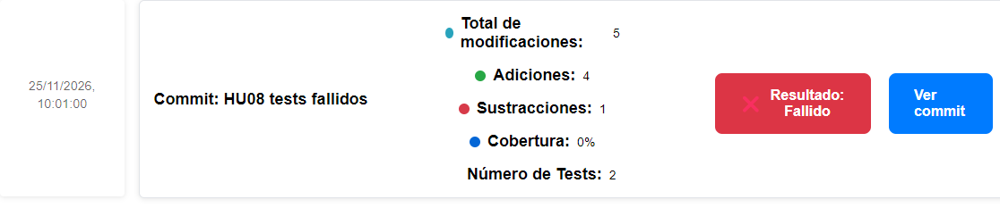
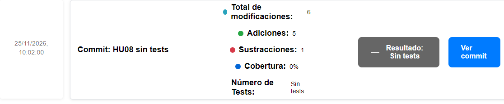
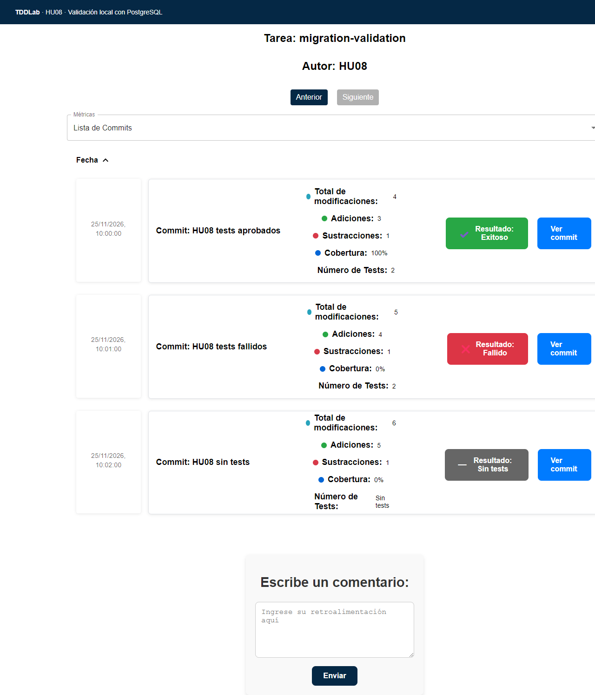
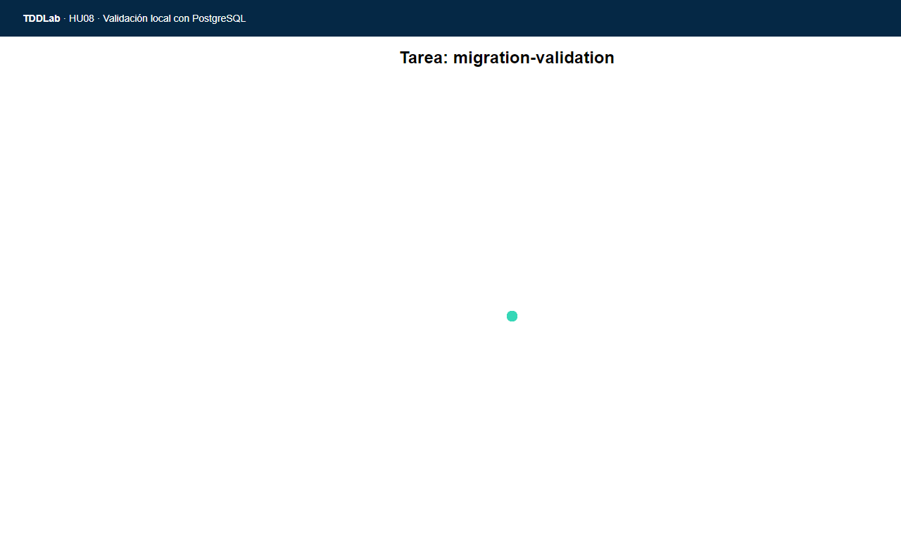
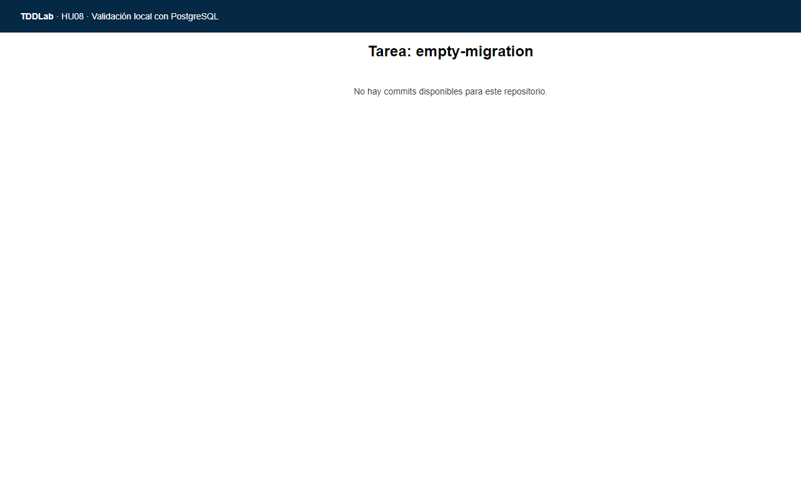
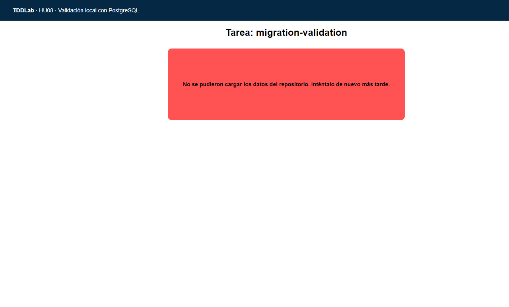
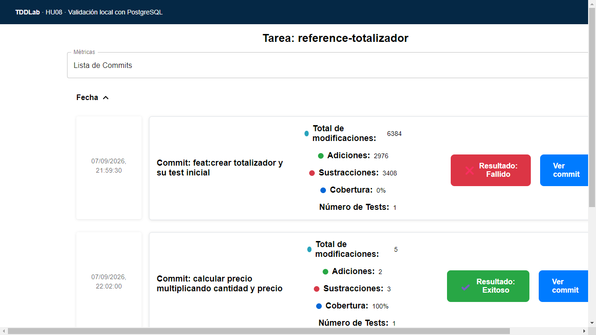
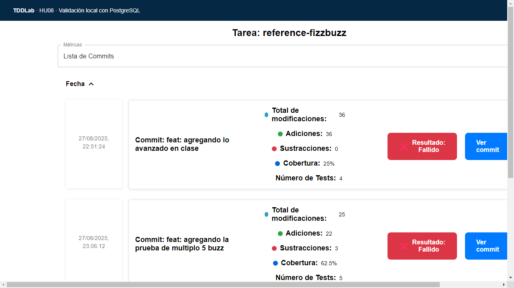
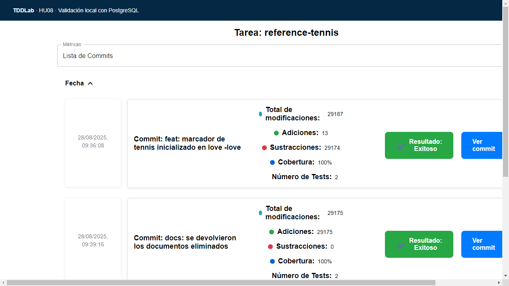

# Documentación de pruebas de la migración HU08

La validación técnica de este repositorio pasa las pruebas de regresión, integración con PostgreSQL y navegador. El cierre global de HU08 queda pendiente del script oficial de HU07, de la publicación en Trello y Notion que el usuario decidió hacer después y de la confirmación del entorno compartido del equipo. Cada pendiente está marcado como no cumplido; no se presenta como una prueba aprobada.

Responsable asignado: Andrés. Apoyo asignado: Carlos. Ejecuciones locales: 25 y 26 de noviembre de 2026, America/La_Paz. Rama revisada: Cachuchines/FrontedyBackend. Commit base: 30685314d3d905e98077a45bac3d1c3938be43f3. El reporte corresponde a ese commit base más los commits de implementación y pruebas de esta entrega, registrados en evidence/commits.json. No se hizo push.

## Alcance y entorno

Se probaron los endpoints de TDDCycles, los casos de uso, los tres adaptadores del par JSON y la página real de visualización con fetch. PostgreSQL 18.4 se inició en una base aislada tddlab_hu08, host 127.0.0.1 y puerto 55408. Se usaron las dependencias instaladas del proyecto, Node.js 24.22.1 para la regresión y compilación final del backend, Node.js 22.23.5 para el frontend y Cypress electron 118.0.5993.159 y TypeScript de los package-lock. La versión final del backend coincide con Node 24 declarado en package.json. La configuración local no acredita una configuración ya desplegada por el equipo.

La página de QA reutiliza TDDChartPage, TDDList, TDDCycleCard, los casos de uso y CommitHistoryAdapter. Solo se aíslan usuario, comentarios y descubrimiento remoto de ramas. Las solicitudes de ingesta, registro, historial y logs de los casos normales llegan a HTTP y PostgreSQL reales. La demora de carga y el error HTTP 500 de la vista se introducen intencionalmente en Cypress; una prueba separada comprueba la caída real de conexión y que el servidor continúa respondiendo.

## Cambios que permiten validar la migración

- La consulta de la vista usa ahora el adaptador seleccionado; antes continuaba leyendo los JSON de GitHub.
- Se conserva el par completo de archivos mediante un contrato común y adaptadores de archivo, falso y PostgreSQL, con una migración versionada y guardado atómico del par.
- La consulta de jobs usa su tabla de registro y evita depender de importar Actions al consultar. Se conservan las ramas y se normaliza el ID interno como número.
- El falso respeta propietario y repositorio. Los registros repetidos y los conflictos se prueban también con concurrencia real.
- La vista distingue cobertura cero y ausencia de tests, conserva las métricas originales y consulta la rama seleccionada en los bloques.
- Se añadieron entradas de QA, fixtures, pruebas automatizadas, evidencias descargadas y documentación reproducible. Se habilitó docs/hu08 en Git; los temporales quedan ignorados.

## Plan corto de pruebas

| Caso | Preparación | Comparación esperada | Evidencia |
|---|---|---|---|
| P01 Aprobados | Ejecutar dos tests correctos y registrar success | 2 tests, 100 por ciento de cobertura y resultado exitoso en JSON BD HTTP y tarjeta | E3 E4 captura 01a |
| P02 Fallidos | Ejecutar uno correcto y uno incorrecto y registrar failure | 2 tests, 1 fallido, cobertura 0 y resultado fallido sin alterar datos | E3 E4 captura 01b |
| P03 Sin tests | Ejecutar el runner sin coincidencias y registrar skipped | 0 tests, cobertura 0 y texto Sin tests; no error de aplicación | E3 E4 captura 01c |
| P04 Repetido | Reenviar un job y el mismo par JSON | HTTP 200 duplicate, una identidad de job y un snapshot por rama; misma lista | E3 E4 captura 02 |

El fallo de P02 es deliberado en un proyecto de muestra separado: es el dato rojo que se migra, no una falla de la regresión de TDDLab. El emisor de QA compara los contadores realmente obtenidos por Jest antes de enviar el fixture. Los scripts oficiales del estudiante quedan fuera de este repositorio.

## Resultados ejecutados

| Verificación | Resultado | Evidencia |
|---|---|---|
| Regresión backend | 513/513 tests; 67/67 suites; 0 fallidos | E1 |
| Regresión frontend | 328/328 tests; 69/69 suites; 0 fallidos | E2 |
| Suite específica HU08 | 38/38 tests; 0 fallidos | E3 |
| Navegador | 8/8 casos; 0 fallidos | E4 |
| Compilación backend | TypeScript emitió build sin errores | E6 |
| Compilación frontend | TypeScript y Vite finalizaron con código 0 | E6 |

La suite HU08 es un subconjunto de la regresión backend; no se suman ambos conteos. Después del último ajuste de importaciones se repitió el grupo afectado del frontend: 39 de 39 tests en nueve suites aprobados. La línea base anterior a los cambios tenía 474 de 475 tests de backend aprobados, con un timeout en la prueba de base no disponible, y 325 de 325 del frontend. Vite informa advertencias de tamaño de chunks y de compatibilidad de datos de navegadores; no son errores de compilación. Las métricas de cobertura están exportadas en los JSON de evidencia; no se confunde cobertura con cantidad de casos aprobados.

## Método de comparación

Para el fixture sin alias se exige igualdad profunda de las dos listas originales con las columnas JSONB consultadas mediante SELECT, incluyendo campos adicionales, acentos, ceros, booleanos, fechas y marcas de tiempo. Se comprueban luego los valores de la respuesta HTTP y de cada tarjeta visible: mensaje, total de modificaciones, adiciones, sustracciones, cobertura, número de tests, estado y enlace. Se prueban además lista vacía, carga, error, repositorios distintos, ramas con barras, migración repetida, reenvíos concurrentes y conflicto sin sobrescritura de la conclusión.

Los tres adaptadores reciben la misma muestra y deben devolver los mismos objetos y tipos. Los Date del contrato se serializan en ISO por HTTP; el historial se ordena por fecha. El ID de job lo genera cada almacenamiento y se compara su tipo, no su valor numérico entre almacenes. El par JSON conserva también campos que la tarjeta nunca mostró; su presencia se verifica en SELECT y en getSnapshot.

Los históricos reales contienen HEAD. Antes de persistir se resuelve solo ese alias en sha y commitId usando el SHA inmutable registrado en el manifiesto. Las copias originales y sus hashes se conservan. No se exige igualdad literal de ese alias con el SHA resuelto; el resto de valores no se cambia. La igualdad es de valores JSON, no de espacios ni orden de claves.

La tabla de snapshots conserva el último par recibido por rama y permite reenvíos idénticos sin duplicar filas. No guarda cada revisión histórica del par ni impide por sí sola que una entrega antigua llegue después de una reciente. Esa política de retención y orden de envío no fue un caso de aceptación de esta ejecución y debe definirse antes de usar el endpoint con productores concurrentes que envíen estados distintos.

## Matriz de criterios

Cumplido significa que existe código y evidencia ejecutada en este alcance. No cumplido identifica una validación o publicación que falta; no equivale necesariamente a un defecto funcional de este repositorio. Hay 41 criterios de HU02 a HU07 y siete de HU08.

### HU02

Criterios cumplidos en este alcance: 7/7.

| ID | Criterio | Estado | Evidencia o pendiente |
|---|---|---|---|
| HU02-1 | Falso en el mismo proyecto y carpeta de adaptadores | Cumplido | E1 FakeDBJobsRepository y TDDResultsRepository |
| HU02-2 | Mismos métodos parámetros y forma de respuesta | Cumplido | E3 contrato común y comparación de valores y tipos |
| HU02-3 | Constantes de aprobados fallidos y sin tests | Cumplido | E1 falso demo/tests y tres fixtures |
| HU02-4 | Caso de uso de consulta conserva su lógica | Cumplido | GetTestResultsUseCase sin cambios de lógica |
| HU02-5 | Cambio de adaptador en un punto de inyección | Cumplido | createTDDCyclesDependencies |
| HU02-6 | Consulta con estructura del contrato y HTTP 200 | Cumplido | E1 rutas y E3 PostgreSQL |
| HU02-7 | Pruebas unitarias de consulta con falso | Cumplido | E1 getTestResultsWithFakeRepository |

### HU03

Criterios cumplidos en este alcance: 6/6.

| ID | Criterio | Estado | Evidencia o pendiente |
|---|---|---|---|
| HU03-1 | Registro independiente del almacenamiento | Cumplido | E1 RegisterTestResultUseCase |
| HU03-2 | JSON del contrato y respuesta HTTP 201 | Cumplido | E1 rutas y E3 registro real |
| HU03-3 | Campos ausentes o inválidos generan 400 identificable | Cumplido | E1 validación y rutas |
| HU03-4 | Registro de punta a punta con falso | Cumplido | E1 TDDCyclesRegistrationApp y Routes |
| HU03-5 | Commit repetido no crea duplicados | Cumplido | E3 concurrencia y E4 reenvío |
| HU03-6 | Unitarias de registro correcto inválido y repetido | Cumplido | E1 registerTestResultUseCase y registrationBranch |

### HU04

Criterios cumplidos en este alcance: 6/7.

| ID | Criterio | Estado | Evidencia o pendiente |
|---|---|---|---|
| HU04-1 | Tablas mediante migración versionada | Cumplido | 008_tdd_migration_validation.sql y E3 doble aplicación |
| HU04-2 | Adaptador de BD con el contrato SELECT e INSERT | Cumplido | E3 tres adaptadores y registro jobs |
| HU04-3 | Sustitución en la inyección conserva casos de uso y rutas | Cumplido | Lógica de consulta igual y fábrica central |
| HU04-4 | Registro recuperado con los mismos campos de negocio | Cumplido | E3 POST GET y SELECT; ID interno generado |
| HU04-5 | BD caída devuelve 500 controlado y servidor sigue vivo | Cumplido | E3 databaseUnavailable y E1 aplicación |
| HU04-6 | Integración de lectura y escritura de BD | Cumplido | E3 PostgreSQL real |
| HU04-7 | Entorno compartido del equipo activo con BD al cierre | No cumplido | Solo se verificó el entorno local; falta confirmación del equipo |

### HU05

Criterios cumplidos en este alcance: 7/7.

| ID | Criterio | Estado | Evidencia o pendiente |
|---|---|---|---|
| HU05-1 | Adaptador fetch cumple el contrato del frontend | Cumplido | E2 CommitHistoryAdapter y E4 HTTP real |
| HU05-2 | Repositorio falso frontend con constantes | Cumplido | FakeCommitHistoryRepository y E2 |
| HU05-3 | Caso de uso frontend conserva su lógica | Cumplido | GetCommitsOfRepo y demás casos sin cambios |
| HU05-4 | Un punto para elegir falso o fetch | Cumplido | VITE_TDD_USE_FAKE en la composición existente |
| HU05-5 | URL backend desde configuración | Cumplido | config.ts VITE_API_URL y constructor del adaptador |
| HU05-6 | Error controlado ante respuesta fallida o sin conexión | Cumplido | E2 fetch HTTP red y timeout; E4 mensaje en vista |
| HU05-7 | Unitarias de fetch correcto y con error | Cumplido | E2 CommitHistoryAdapter |

### HU06

Criterios cumplidos en este alcance: 6/7.

| ID | Criterio | Estado | Evidencia o pendiente |
|---|---|---|---|
| HU06-1 | Vista de bloques usa el nuevo repositorio sin rediseño | Cumplido | E4 página y componentes reales más capturas |
| HU06-2 | Bloques conservan la información de los archivos | Cumplido | E4 métricas mensajes enlaces y muestras reales |
| HU06-3 | Indicador durante la carga | Cumplido | E4 demora de respuesta real y captura 03 |
| HU06-4 | Mensaje cuando no hay commits | Cumplido | E4 consulta vacía real y captura 04 |
| HU06-5 | Error entendible sin romper la aplicación | Cumplido | E4 HTTP 500 simulado y captura 05 |
| HU06-6 | Constancia de falso en semana uno y reales en semana dos | No cumplido | Compatibilidad técnica verificada; falta evidencia histórica de las dos semanas |
| HU06-7 | Gráfica de línea de tiempo multirrama fuera del alcance | Cumplido | No se implementó una nueva gráfica multirrama |

### HU07

Criterios cumplidos en este alcance: 0/7.

| ID | Criterio | Estado | Evidencia o pendiente |
|---|---|---|---|
| HU07-1 | Scripts forman el JSON del contrato | No cumplido | Pendiente en el otro repositorio por alcance acordado |
| HU07-2 | Envío automático después de ejecutar tests | No cumplido | Solo se verificó un emisor controlado de QA |
| HU07-3 | URL del script desde configuración | No cumplido | Pendiente revisar scripts oficiales de HU07 |
| HU07-4 | Fallo de envío no interrumpe trabajo y deja error | No cumplido | Pendiente probar hooks y fallos en el otro repositorio |
| HU07-5 | Archivo actual continúa como respaldo durante el sprint | No cumplido | Pendiente verificar escritura del script oficial |
| HU07-6 | Envíos contra falso y BD en las semanas previstas | No cumplido | Sin evidencia de los scripts oficiales ni de ambas semanas |
| HU07-7 | Cambios de scripts documentados como continuación del análisis | No cumplido | Pendiente documentación HU07 en el otro repositorio |

### HU08

Criterios cumplidos en este alcance: 4/7.

| ID | Criterio | Estado | Evidencia o pendiente |
|---|---|---|---|
| HU08-1 | Plan corto con aprobados fallidos sin tests y repetido | Cumplido | Plan de cuatro casos y fixtures versionados |
| HU08-2 | Comparación JSON BD y vista coincidente por caso | Cumplido | E3 E4 E5 y capturas de los cuatro casos |
| HU08-3 | Flujo completo con script oficial ejecutar enviar consultar y visualizar | No cumplido | Flujo local con emisor QA aprobado; script oficial HU07 pendiente |
| HU08-4 | Archivo falso y BD devuelven la misma forma | Cumplido | E3 comparación de objetos valores tipos fechas y ramas |
| HU08-5 | Defectos en Trello y bloqueantes corregidos | No cumplido | D01 a D10 corregidos localmente; publicación diferida por el usuario |
| HU08-6 | Todos los criterios HU02 a HU07 marcados con evidencia | Cumplido | Esta matriz y acceptance-matrix.json |
| HU08-7 | Reporte en repositorio y Notion de cada integrante | No cumplido | Archivos locales listos; publicación en Notion diferida por el usuario |

## Repositorios reales del documento de referencia

Se consultaron los tres enlaces del Word y se fijaron sus revisiones para repetir las pruebas sin depender de cambios posteriores.

| Fuente | Historial | Log de tests | Resultado |
|---|---|---|---|
| [Totalizador](https://github.com/Luiscuac/TotalizadorVentasIngSoftware) | 13 commits | 29 entradas | Comparación de ambos archivos en los tres adaptadores y bloques |
| [Fizzbuzz](https://github.com/HenryRiveraM/fizzbuzz) | 5 commits | HTTP 404 | Historial comparado y log vacío declarado |
| [TennisPlay](https://github.com/RashLop/TennisPlay) | 9 commits | HTTP 404 | Historial comparado y log vacío declarado |

Los SHA y SHA256 se conservan en E7. No se ejecutó código de esos repositorios ni se acreditó un log ausente. La prueba no utiliza sus ramas como destinos de escritura.

## Evidencia visual

Las siguientes imágenes son capturas obtenidas por Cypress de la página y componentes reales en la instancia local. Las capturas de error y carga corresponden a los escenarios controlados descritos; no se presentan como capturas de producción ni como una sesión autenticada completa del estudiante o docente.

### Tests aprobados

### Tests fallidos

### Commit sin tests

### Reenvío y vista docente

### Indicador de carga

### Repositorio vacío

### Error controlado

### Muestra de Totalizador

### Muestra de Fizzbuzz

### Muestra de TennisPlay

## Defectos y pendientes para cierre

Las fichas D01 a D10 describen el problema, los pasos de reproducción, la corrección y sus pruebas. Los bloqueantes locales de consulta desde archivo, dependencia de la tabla auxiliar e inicialización de la página están corregidos. La publicación real de las tarjetas y el reporte en Notion se pospuso expresamente; no existen enlaces de tarjetas inventados.

Antes del cierre global se necesita validar los scripts oficiales en el otro repositorio, publicar las fichas en Trello y el reporte en los apartados de Notion, confirmar la BD activa y la migración de los históricos en el entorno compartido, y adjuntar la evidencia temporal de semana uno y semana dos. El backend se verificó localmente con Node 24; la configuración del despliegue corresponde al equipo.

## Índice de evidencia y reproducción

- E1 [Regresión backend](evidence/server-jest.json) y [salida de ejecución](evidence/server-tests.txt).
- E2 [Regresión frontend](evidence/web-jest.json), [salida de ejecución](evidence/web-tests.txt) y [repetición del grupo afectado](evidence/web-visualization-retest.txt).
- E3 [Suite HU08](evidence/integration-jest.json), con conexión real y comparación de adaptadores.
- E4 [Casos de navegador](evidence/cypress-results.json), sus capturas y [runner de muestra](evidence/probe-test-results.json).
- E5 [SELECT de comprobación](evidence/database-select.json) del fixture y jobs sin duplicados.
- E6 [Códigos de salida](evidence/check-exit-codes.json), [backend](evidence/server-build.txt), [frontend](evidence/web-build.txt) y [Vite](evidence/vite-build.txt).
- E7 [Fuentes SHA y hashes](evidence/references/reference-check.json) y copias originales descargadas.
- E8 [Matriz exportada](acceptance-matrix.json) y [fichas listas para Trello](DEFECTOS_TRELLO.md).
- E9 [Procedimiento reproducible](REPRODUCCION.md), variables y contratos de los endpoints.

Ejecutar la migración en una base exclusiva, configurar TDDLAB_TEST_DATABASE_URL y usar npm run test:hu08:integration desde server. Mantener npm run qa:hu08 en server y Web Ui para la prueba visual, y ejecutar npm run test:hu08:e2e desde Web Ui con la misma URL de prueba. Los detalles completos y las limitaciones están en E9. Aplicar el esquema y cargar los históricos antes de activar el repositorio de BD en un entorno compartido.
